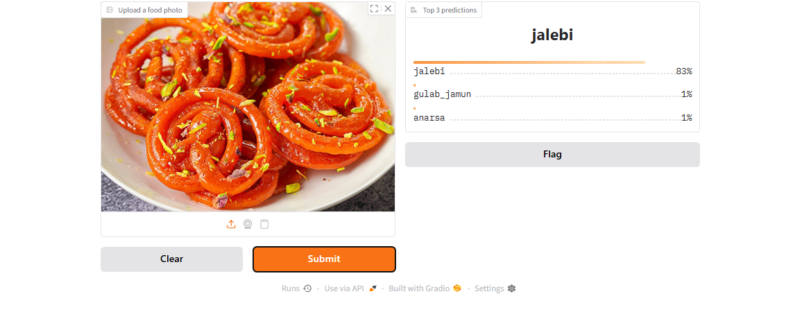

# Indian Food Classifier

A deep learning project that recognizes **80 Indian dishes** from a photo.
It uses **transfer learning** with EfficientNet-B0 and reaches **70.0% top-1 accuracy** and **88.1% top-3 accuracy** on test images the model never saw during training.



---

## Table of Contents

1. [Project Goal](#1-project-goal)
2. [Dataset](#2-dataset)
3. [How the Data Was Prepared](#3-how-the-data-was-prepared)
4. [Step-by-Step Journey: How I Improved the Accuracy](#4-step-by-step-journey-how-we-improved-the-accuracy)
5. [Final Results](#5-final-results)
6. [Error Analysis: Where the Model Fails and Why](#6-error-analysis-where-the-model-fails-and-why)
7. [Demo App](#7-demo-app)
8. [Limitations](#8-limitations)
9. [How to Run This Project](#9-how-to-run-this-project)
10. [Project Structure](#10-project-structure)
11. [What I Learned](#11-what-i-learned)
12. [Credits](#12-credits)

---

## 1. Project Goal

The goal was to learn how to train an image model on custom data, from start to finish:

- load and understand a dataset
- train a model and measure it honestly
- improve it
- study its mistakes
- turn it into a working demo app

The project was built on **Kaggle** using the free **Tesla T4 GPU**, with **PyTorch**.

---

## 2. Dataset

- **Name:** Indian Food Images Dataset
- **Author:** Sourav Banerjee (Kaggle)
- **Link:** https://www.kaggle.com/datasets/iamsouravbanerjee/indian-food-images-dataset
- **License:** Other / not specified. Kaggle lists the license as "Other (specified in description)", but the author's description gives no usage terms. The author states the dataset was created from Google Images, so the copyright of the individual images belongs to their original owners (some images carry Shutterstock/Alamy watermarks).
This project uses the dataset for educational/research purposes only and does not redistribute it. Please download the dataset from the Kaggle link above.

| Property | Value |
|---|---|
| Number of classes | 80 Indian dishes |
| Images per class | 50 (perfectly balanced) |
| Total images | 4,000 |

The dataset is **not** included in this repository. Please download it from the Kaggle link above.

### What I noticed in the data

Before training, I looked at sample images and found several things that make this dataset hard:

- **Image sizes differ a lot** (for example 177x284 and 1200x800), so all images had to be resized.
- **Watermarks** (like Shutterstock and Alamy) appear on some images. A model can accidentally learn "watermark = this dish" instead of learning the food.
- **Text on images** is present in some photos (for example, Odia text on one image).
- **Near-duplicate images** exist in some classes, which can make test scores look better than they really are.
- **Lookalike dishes** exist, such as basundi, phirni, rabri and doodhpak (all creamy milk desserts).

---

## 3. How the Data Was Prepared

**Split (stratified, so every class appears in every split):**

| Split | Images per class | Total |
|---|---|---|
| Train | 35 | 2,800 |
| Validation | 7 | 560 |
| Test | 8 | 640 |

A fixed random seed (`42`) was used so the split is the same every time.

**Image transforms:**

- **Training images:** random resized crop (224x224), horizontal flip, color jitter. Later, stronger augmentation was added (see Experiment 3).
- **Validation and test images:** resize to 256, center crop to 224. No random changes, so the evaluation is fair.
- **Normalization:** ImageNet mean and standard deviation, because the pretrained models expect it.

**Important rule:** the test set was kept untouched until the very end. All tuning decisions were made using the validation set only.

---

## 4. Step-by-Step Journey: How I Improved the Accuracy

I changed **one thing at a time**, so I could clearly see what helped and what did not.

### Experiment 0: Baseline (frozen ResNet18)

- **Idea:** Use ResNet18 pretrained on ImageNet. Freeze the whole network (the "backbone") and train only a new final layer (the "head") for 80 classes.
- **Trainable parameters:** 41,040 out of about 11.2 million.
- **Result:** about **49.5% validation accuracy**.
- **What I learned:** Training accuracy reached 73% while validation stayed near 50%. The frozen ImageNet features are too general. They know "brown, round, fried" but cannot tell similar Indian dishes apart.

### Experiment 1: Fine-tune the backbone

- **Change:** Unfroze the last two blocks (`layer3` and `layer4`) of ResNet18.
- **Also added:**
  - **Different learning rates:** `1e-4` for the pretrained layers (gentle updates) and `1e-3` for the new head (bigger updates).
  - **Label smoothing (0.1):** stops the model from becoming too confident.
  - **AdamW optimizer** with weight decay, and a **cosine learning rate schedule**.
- **Result:** about **66-67% validation accuracy** (best epoch 67.9%).
- **What I learned:** Letting the model adapt its features to food gave a big jump of about +17 points. But training accuracy hit 99.4% while validation stayed near 67%. The model was **memorizing** the 2,800 training images (overfitting).

### Experiment 2: Stronger data augmentation

- **Change:** Made each training image look different every epoch, using:
  - **TrivialAugmentWide:** a random strong transform (rotation, shear, color and contrast changes, and so on)
  - **RandomErasing:** hides a random patch of the image, so the model cannot depend on one small detail like a watermark
  - a wider random crop range
- **Result:** about **68-70% validation accuracy** (best epoch 69.6%).
- **What I learned:** Training accuracy dropped to about 91% (less memorizing) and validation became more stable. The gain was small, about 2-3 points. So augmentation helped a little, but it was not the main limit.

### Experiment 3: A stronger model (EfficientNet-B0)

- **Change:** Swapped ResNet18 for EfficientNet-B0. Unfroze the last 3 blocks of the backbone and added a dropout layer (0.3) before the final layer. Kept the same augmentation, so only the model changed.
- **Result:** about **70-71% validation accuracy** (best epoch 71.8%).
- **What I learned:** The gain was small again (about 1-2 points, which is close to noise on 560 validation images). After two experiments with small gains, it was clear the limit was now the **data and the task**, not the model: only 35 training images per class, many lookalike dishes, and noisy images.

### Final step: Evaluate once on the test set

The best EfficientNet-B0 model (chosen using validation accuracy) was run **one time** on the 640 untouched test images.

---

## 5. Final Results

| Experiment | What changed | Validation accuracy |
|---|---|---|
| 0. Baseline | ResNet18, only the final layer trained | ~49.5% |
| 1. Fine-tuning | Unfroze last 2 blocks, different learning rates, label smoothing | ~67% |
| 2. Augmentation | TrivialAugmentWide + RandomErasing | ~69.5% |
| 3. Better model | EfficientNet-B0 | ~71.8% |

**Final test results (640 unseen images):**

| Metric | Score |
|---|---|
| **Top-1 accuracy** | **70.0%** |
| **Top-3 accuracy** | **88.1%** |

For comparison, random guessing would give 1.25% (top-1) and 3.75% (top-3).

**How to read these numbers:**

- The test score (70.0%) is slightly lower than the best validation score (71.8%). This is expected, because the best epoch was picked using validation data. The small gap shows I did not overfit to the validation set.
- **Top-3 accuracy** is a fair metric here. With 80 dishes and many lookalikes, "the right answer is in the top 3 guesses" is what a real user cares about.
- Each validation class has only 7 images, so differences of 1-2% are mostly noise.

---

## 6. Error Analysis: Where the Model Fails and Why

I studied the validation predictions to understand the mistakes.

### Best classes

Distinctive dishes were recognized perfectly (100%), for example: `jalebi`, `lassi`, `bhatura`, `boondi`, `dal_makhani`, `palak_paneer`, `kofta`.

### Worst classes and what they get confused with

| Dish | Accuracy | Confused with | Why |
|---|---|---|---|
| adhirasam | 14% | ariselu | Both are round, brown, fried jaggery sweets |
| ledikeni | 14% | gulab_jamun | Ledikeni is a variant of gulab jamun |
| doodhpak | 14% | sheer_korma | Both are milky desserts |
| chicken_tikka_masala | 29% | butter_chicken | Both are orange creamy chicken gravies |
| basundi | 43% | phirni | Thick milk desserts served in bowls |
| butter_chicken | 43% | chicken_tikka_masala | Same as above |

### Key findings

1. **Most errors are between true lookalikes.** The model is making reasonable mistakes.
2. **Some errors come from bad images or labels**, not the model. For example, a `chhena_kheeri` image shows only cheesecloth and a ball of paneer (not the finished dish), and a `karela_bharta` image is a collage of two pans.
3. **Confidence was low on most errors (17-49%).** The model was mostly "unsure", which is healthy behavior.
4. **Some errors are real model weaknesses.** For example, `chicken_tikka` was once predicted as `aloo_tikki`, which a bigger model or more data should fix.

**Conclusion:** About 70% is close to the realistic limit for this dataset with 35 training images per class. The remaining errors come mostly from ambiguous classes and noisy data.

---

## 7. Demo App

The trained model is wrapped in a simple **Gradio** web app. You upload a food photo and get the **top 3 predictions** with confidence scores.

I tested the demo on 4 photos I found online (not from the dataset):

| Photo | Prediction | Result |
|---|---|---|
| Jalebi | jalebi (83%) | Correct |
| Fried bread with yellow curry | bhatura (39%) | Likely correct |
| Halwa in a white bowl | sheera (64%) | Plausible |
| Dhokla | mysore_pak (42%) | Wrong (dhokla is not one of the 80 classes) |

### Lessons from the demo

- **Closed-set problem:** The model can only choose from the 80 dishes it was trained on. If a photo shows something else (like dhokla), it still guesses one of the 80.
- **Confidence is a useful signal.** Wrong answers outside the label set usually had low confidence (13-42%).
- **Confidence threshold:** `app.py` shows "not sure (maybe not in my 80 dishes)" when the top confidence is below 30%. This catches many out-of-set photos, but not all (the raita photo was wrong at 55%).
- **One dish per image:** The model assumes one dish per photo, so photos with two foods can confuse it.

---

## 8. Limitations

- Only **80 dishes**. Many popular Indian dishes (dhokla, pani puri, dal rice, and more) are missing.
- Only **35 training images per class**, which is small.
- **Noisy web images:** watermarks, text overlays, near-duplicates and a few wrong or unclear labels.
- **One dish per photo** is assumed.
- **Lookalike dishes** (for example butter chicken vs chicken tikka masala) remain hard to separate.
- The model has no true "none of these" option. The confidence threshold is only a partial fix.
- Results come from a single data split and a single training run, so small differences (1-2%) should not be over-interpreted.

---

## 9. How to Run This Project

### Option A: Run the demo app

```bash
# 1. Clone the repository
git clone https://github.com/Ishika-Gadhwal/indian-food-classifier.git
cd indian-food-classifier

# 2. Install requirements
pip install -r requirements.txt

# 3. Start the app
python app.py
```

Then open the local link shown in the terminal and upload a food photo.

### Option B: Retrain the model

1. Create a Kaggle notebook and turn on a **GPU (T4)**.
2. Add the **Indian Food Images Dataset** using "Add Input".
3. Upload `notebook.ipynb` (or copy its cells) and run them in order from top to bottom.
4. Update the `DATA_DIR` path in the notebook if your dataset path is different.

### Requirements

`torch`, `torchvision`, `gradio`, `pillow`, `matplotlib`, `numpy`

---

## 10. Project Structure

```
indian-food-classifier/
├── README.md               # this file
├── notebook.ipynb          # full training and evaluation notebook
├── app.py                  # Gradio demo app
├── food_classifier.pt      # trained EfficientNet-B0 weights
├── class_names.json        # list of the 80 class names
├── requirements.txt        # Python packages
└── images/                 # screenshots and plots
```

---

## 11. What I Learned

- **Transfer learning** is the right tool when data is small. A pretrained model already knows edges, textures and shapes.
- **Frozen vs fine-tuned layers:** training only the head gave about 50%, while fine-tuning the last blocks gave about 67%.
- **Overfitting** is easy to see by comparing training and validation curves.
- **Change one thing at a time** so you know what really helped.
- **Keep the test set untouched** until the end, otherwise the final score is not honest.
- **Error analysis** is more useful than chasing a higher number. It showed that the model's limits come from the data, not only from the model.
- **Real-world models need data coverage.** The model cannot recognize what it was never taught.

---

## 12. Credits

- **Dataset:** Indian Food Images Dataset by Sourav Banerjee, on Kaggle.
- **Models:** ResNet18 and EfficientNet-B0, pretrained on ImageNet, from `torchvision`.
- **Tools:** PyTorch, Gradio, Kaggle Notebooks (Tesla T4 GPU).

---

**Author:** *Ishika Gadhwal* ([GitHub profile](https://github.com/Ishika-Gadhwal))
